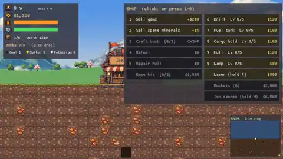
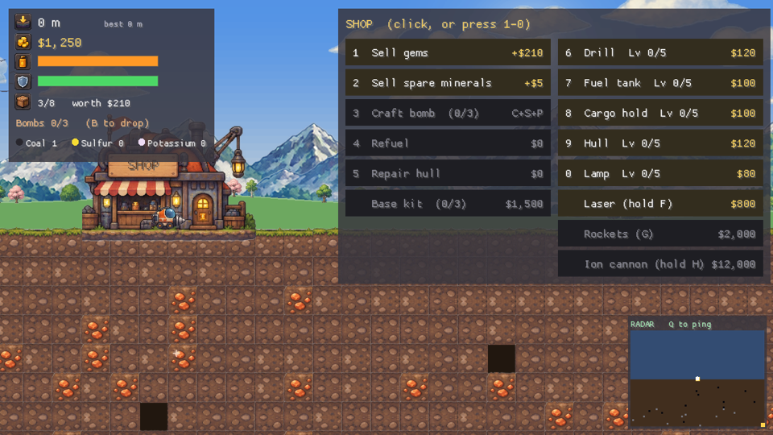
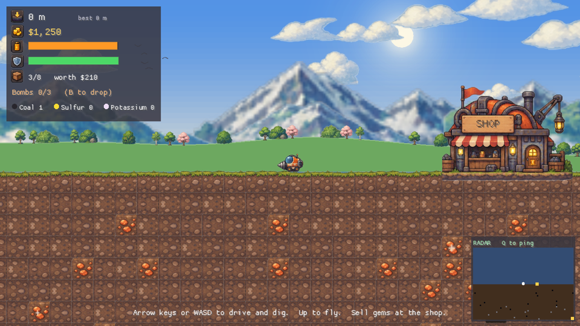
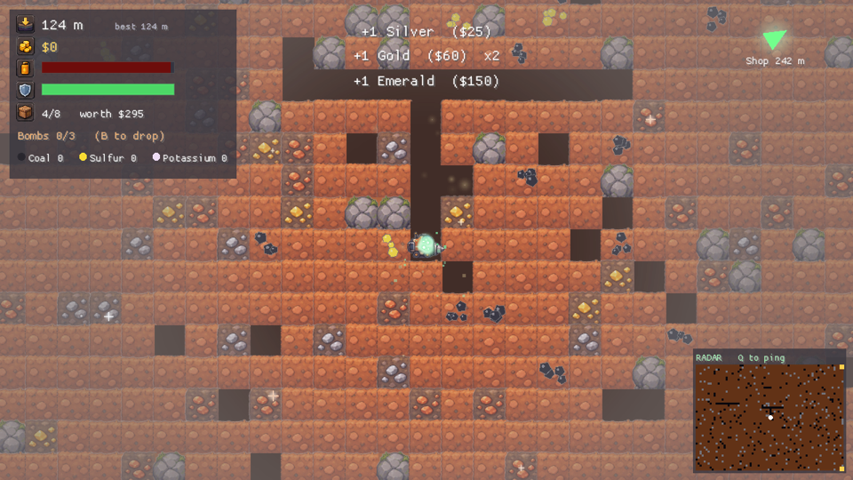
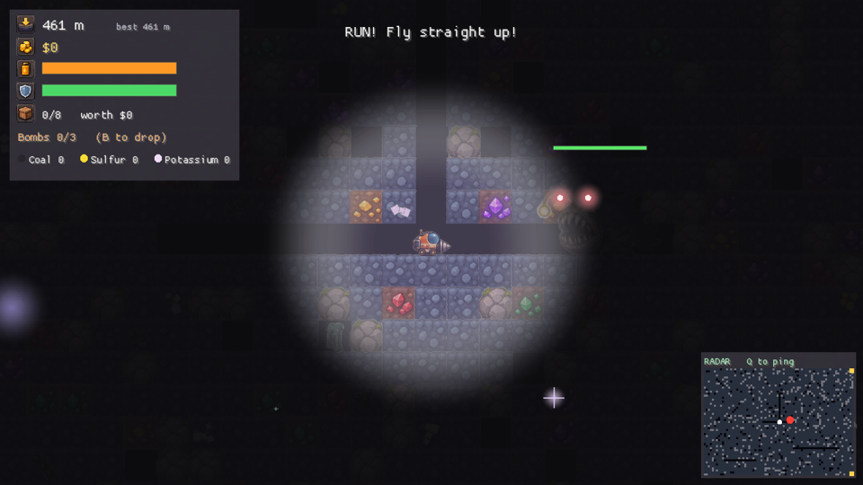
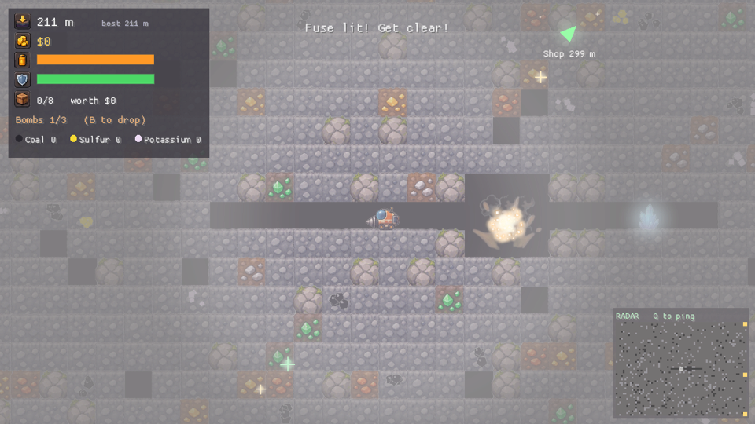
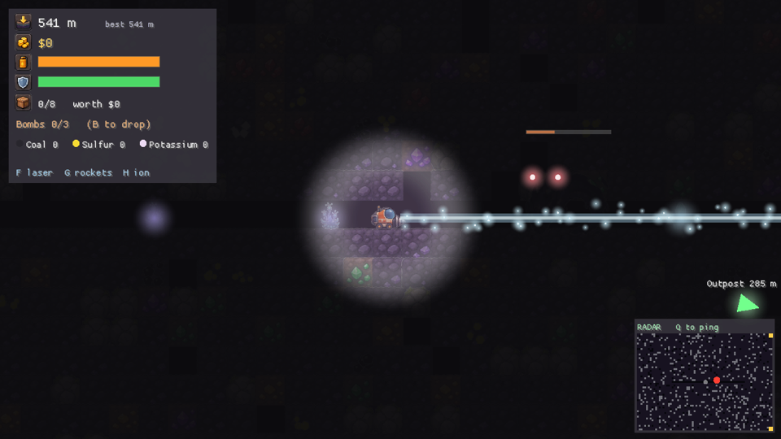
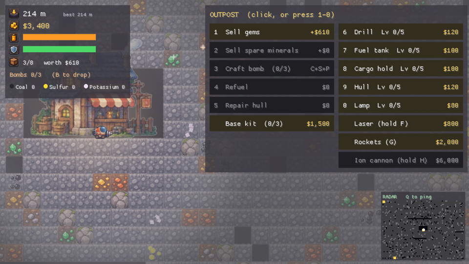
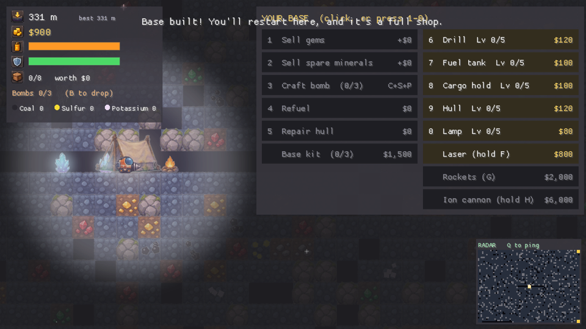

# GemDigger

A cozy-to-creepy digging game. Drill down, collect gems, sell them at the shop, upgrade, and see how deep you dare to go.

[Watch the clip as MP4](media/gameplay.mp4)

| | |
|---|---|
|  |  |
|  |  |
|  |  |
|  |  |

## Installation

Download from the [latest release](https://github.com/bluefishforsale/gemdigger/releases/latest). No account needed.

- **Windows:** download `gemdigger.exe` and run it. To install it on your PATH instead, run `install-windows.ps1` from PowerShell; it checks the download against the release's `SHA256SUMS`.
- **macOS:** download `gemdigger-macos.dmg`, open it, and drag GemDigger into the Applications folder beside it.

Releases are code-signed: the Windows exe with an Authenticode signature, and the Mac app with a Developer ID, notarized by Apple. (v0.1.0 came before signing, so Windows warns about it.)

## Gameplay

Drive with the arrow keys or WASD. Push into the ground to dig sideways or down, and press up or space to fly. Dig up gems, fly back to the shop to sell them, and spend the money on upgrades. Watch your fuel; running dry underground ends the run.

The deeper you go, the darker and stranger it gets. Monsters live down there. You always get a warning first, a rumble and a shaking screen. They only move side to side, so flying straight up always gets you away.

Bigger monsters take more hits, and a health bar shows how the fight is going. The biggest only feel bombs and the ion cannon, so sometimes the right move is still to fly. Killing a monster with a bomb, rocket or the ion cannon can drop a relic, a permanent bonus that goes past the shop's max level.

Every couple of hundred meters down there's an outpost, a full shop in a cavern, and you can buy base kits to build your own. The radar in the corner and an arrow on the screen edge point you to the nearest one.

Losing the pod isn't the end: you start again at your nearest base, or the surface, with your money and upgrades. The gems you were carrying stay where you fell, and an arrow points the way back to them.

| Key | What it does |
|---|---|
| Arrows or WASD | Drive, dig, and fly (up or space) |
| 1 to 0, or click | Buy and sell at a shop |
| B | Drop a bomb |
| F (hold) | Laser |
| G | Rocket |
| H (hold, then let go) | Ion cannon |
| Q | Radar ping: shows nearby ore |
| P | Build a base here |
| T twice | Sacrifice your cargo to teleport to the nearest shop |
| K twice | Self-destruct: lose your cargo and start again at the surface shop |
| ESC | Settings |

## Features

- An endless mine that goes down forever, with rarer gems the deeper you dig
- Five depth zones, from sunny topsoil to a dark abyss, each with its own music
- Daylight stops at the mouth of the shaft, and the light shrinks as you descend
- Six kinds of monsters with health bars, from void spiders to the Shadow Leviathan and the Deep One
- A laser, rockets and a charge-up ion cannon, bought at the shop
- Rare relics dropped by monsters, permanent bonuses past the max upgrade
- A mine 512 columns wide, with deep outposts every couple of hundred meters
- Build your own bases: a full shop, and where you restart after a fall
- A radar mini-map with a sonar ping for ore, and an arrow to the nearest shop
- Teleport home by sacrificing your cargo
- Self-destruct to get out of any hole, at the cost of whatever you were carrying
- Lost cargo waits where you fell, with an arrow pointing back to it
- Nothing is ever destroyed: gems that don't fit in a full hold stay glinting where you dug them
- The fuel bar turns red and flashes faster as you near the point of no return
- Run dry on the surface with no money and you're quietly towed back to the shop
- Upgrades for drill, fuel tank, cargo hold, hull and lamp
- Craft bombs from Coal, Sulfur and Potassium to blast through boulders and monsters
- A painted sky with mountains, drifting clouds, trees and birds
- Rare critter dens sealed in the rock: dig one open and they come out biting, and a shot critter drops meat to sell
- Supply crates hidden in the rock, usually a bomb, once in a long while a gun or a full tank
- Buried ruins from a dozen lost civilizations, each with a relic waiting inside
- Painted cave walls behind every tunnel, a different one for each depth band
- Saves automatically, so you always pick up where you left off
- An Esc menu with settings for music, sound effects, screen shake and full screen, plus New game to start over on a freshly rolled map

## Technologies

- [Rust](https://www.rust-lang.org) and [macroquad](https://macroquad.rs) for the game
- A seeded procedural world; the save only stores the tiles you've dug
- Music and sound effects synthesized in code at startup
- Pixel art from an image-model sprite atlas, built into the game
- GitHub Actions to build, test, sign and publish releases
- Azure Artifact Signing for Windows, plus Apple Developer ID and notarization for macOS

## OS compatibility

| OS | Status |
|---|---|
| Windows 10 and 11, x64 | Supported |
| macOS 11 Big Sur and later, Apple Silicon and Intel | Supported |
| Linux | No release build yet |
