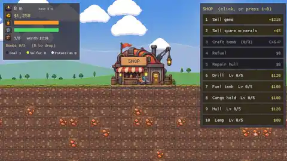
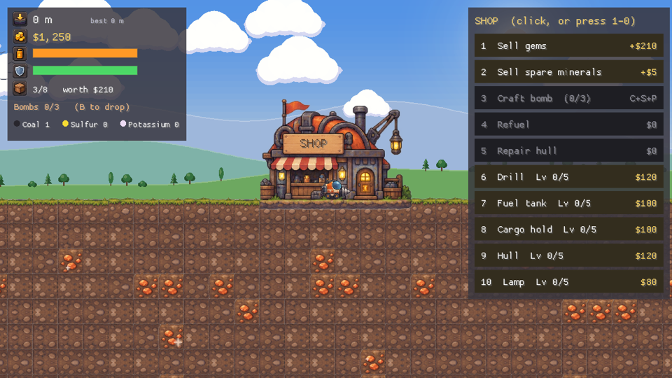
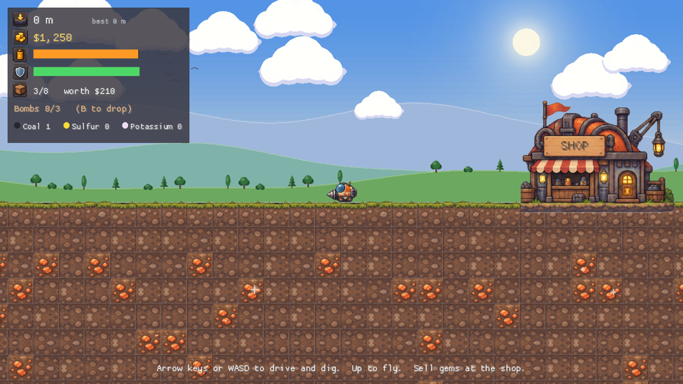
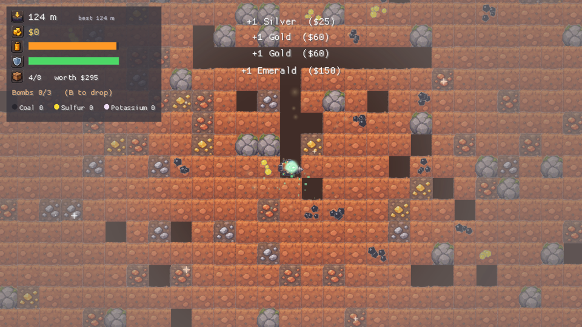
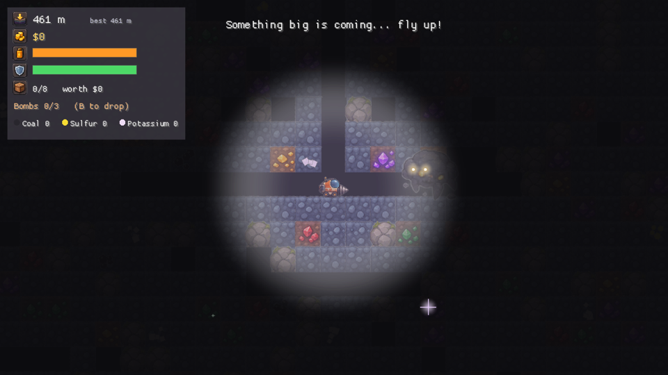
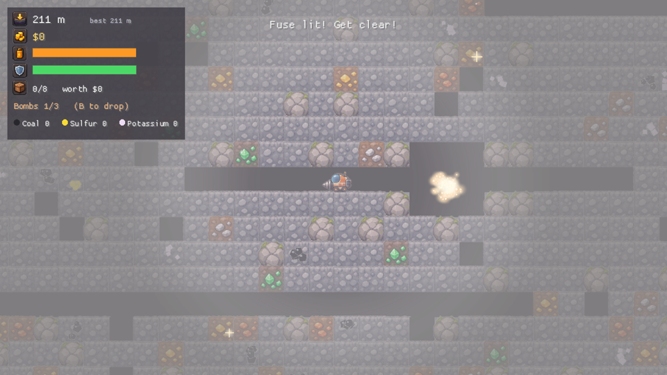

# GemDigger

A cozy-to-creepy digging game. Drill down, collect gems, sell them at the shop, upgrade, and see how deep you dare to go.

[Watch the clip as MP4](media/gameplay.mp4)

| | |
|---|---|
|  |  |
|  |  |
|  | |

## Installation

Download from the [latest release](https://github.com/bluefishforsale/gemdigger/releases/latest). No account needed.

- **Windows:** download `gemdigger.exe` and run it. To install it on your PATH instead, run `install-windows.ps1` from PowerShell; it checks the download against the release's `SHA256SUMS`.
- **macOS:** download `gemdigger-macos.zip`, unzip it, and drag `GemDigger.app` into Applications.

Releases are code-signed: the Windows exe with an Authenticode signature, and the Mac app with a Developer ID, notarized by Apple. (v0.1.0 came before signing, so Windows warns about it.)

## Gameplay

Drive with the arrow keys or WASD. Push into the ground to dig sideways or down, and press up or space to fly. Dig up gems, fly back to the shop to sell them, and spend the money on upgrades. Watch your fuel; running dry underground ends the run.

The deeper you go, the darker and stranger it gets. Monsters live down there. You always get a warning first, a rumble and a shaking screen. They only move side to side, so flying straight up always gets you away.

Losing the pod isn't the end: you start again at the shop with your money and upgrades. The gems you were carrying stay where you fell, and an arrow points the way back to them.

At the shop, click a row or press 1 to 0. ESC opens settings, and B drops a bomb.

## Features

- An endless mine that goes down forever, with rarer gems the deeper you dig
- Five depth zones, from sunny topsoil to a dark abyss, each with its own music
- The light shrinks as you descend, and gems twinkle in the dark
- Monsters that warn you before they appear, from small worms to the Deep Thing
- Lost cargo waits where you fell, with an arrow pointing back to it
- Upgrades for drill, fuel tank, cargo hold, hull and lamp
- Craft bombs from Coal, Sulfur and Potassium to blast through boulders and monsters
- A layered sky with drifting clouds, hills, trees and birds
- Saves automatically, so you always pick up where you left off
- Settings for music, sound effects, screen shake and full screen

## Technologies

- [Rust](https://www.rust-lang.org) and [macroquad](https://macroquad.rs) for the game
- A seeded procedural world; the save only stores the tiles you've dug
- Music and sound effects synthesized in code at startup
- Pixel art from an image-model sprite atlas, built into the game
- GitHub Actions to build, test, sign and publish releases
- Azure Artifact Signing for Windows, plus Apple Developer ID and notarization for macOS

## OS compatibility

| OS | Status |
|---|---|
| Windows 10 and 11, x64 | Supported |
| macOS 11 Big Sur and later, Apple Silicon and Intel | Supported |
| Linux | No release build yet |
